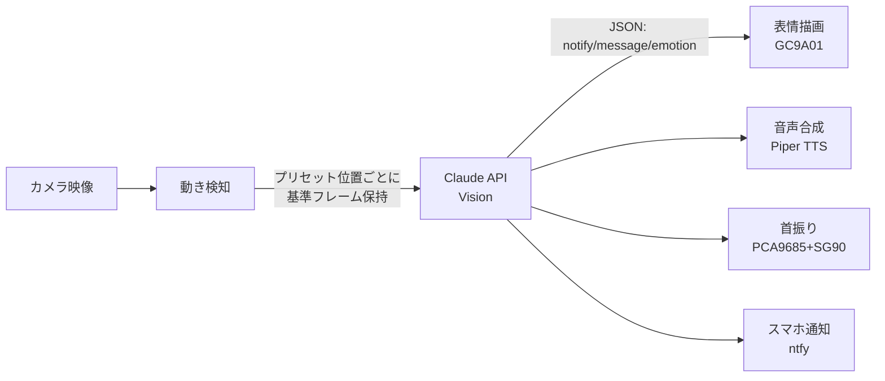
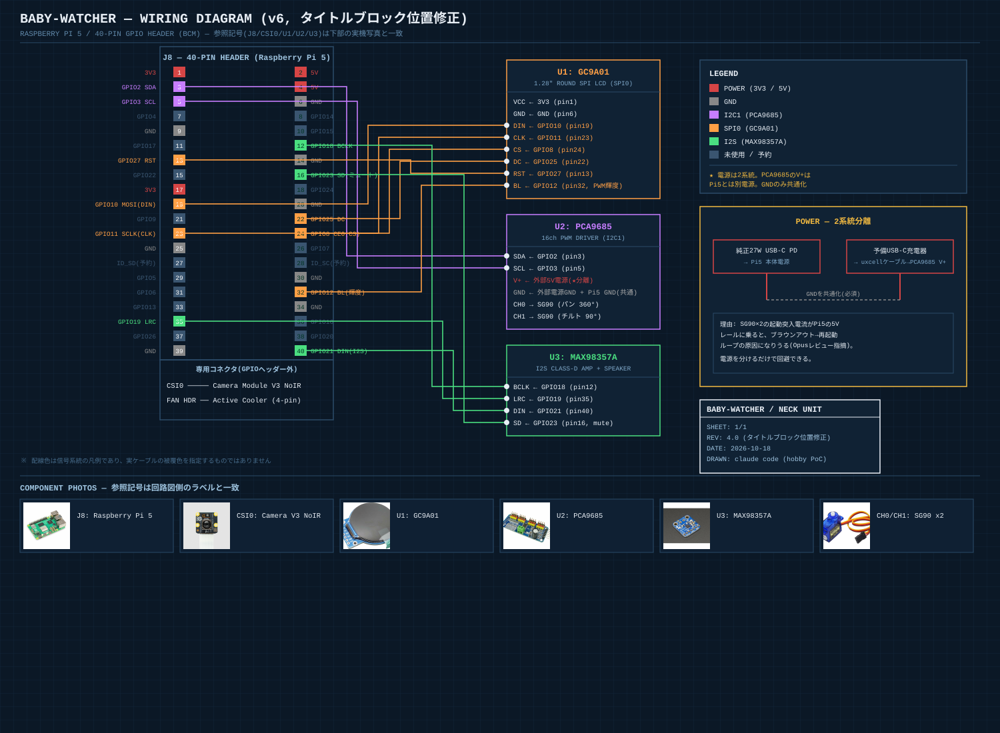

# はじめに

先日、第一子が生まれました。

夜中に何度も起きてはベビーベッドをのぞきに行く生活の中で、ふと「市販のベビーモニターって、結局ただの監視カメラなんだよな」と思うようになりました。異常があれば通知してくれるのはありがたいけれど、もう少し、赤ちゃんのそばに"温かいもの"がいてくれたらいいのに——そんな思いつきから、**赤ちゃんに語りかけてくれる見守りロボット**を作ってみることにしました。

> 📷 **ここに写真を貼る: ベビーベッドまわりの様子**
> 完成イメージが伝わるように、実際に設置する予定の部屋の雰囲気が分かる写真。赤ちゃん自身の顔が写らないよう、部屋の隅やベッドの柵などにフォーカスした構図でお願いします。

せっかくなので、設計からコーディングまでClaude Codeと一緒に進めることにしました。一人で黙々と設計するのではなく、AIに部品を調べさせたり、設計そのものを別のAIにレビューさせたりと、今までと違う作り方を試しているので、その過程を記録として残していきます。

実装の詳細(ソフトウェア)や物理的な組み立て手順は続編に分けます。本記事は**コンセプト〜アーキテクチャ確定まで**です。

※あくまで個人のPoCです。育児の安心材料のひとつではありますが、乳児の安全監視そのものを代替するものではありません。

# 開発の進め方

ベースになっているのは、動き検知→Claude Vision APIで画像判定→スマホ通知、という最小構成の見守りスクリプト`baby_watcher.py`です。これをClaude Code上で拡張していきました。コードを書かせるだけでなく、

- ハードウェア構成の是非を相談する
- 部品ごとの実売価格・レビューを調べさせて選定させる
- 設計全体を**別のモデル(Opus)に独立レビューさせる**

といった使い方をしています。以下、実際の設計過程に沿って書きます。

# コンセプト設計

## 当初案: ぬいぐるみへの内蔵

最初は「ぬいぐるみの中にRaspberry Piとセンサー類を埋め込む」構想でした。StackChan(M5Stack社の、円形/角型ディスプレイの顔+パン/チルトサーボの首振り機構を持つオープンソースロボット)のような、表情豊かな見た目を狙っていました。

## 方針転換: 据え置き型へ

設計を詰める過程で、**乳児の寝床に柔らかい物を入れることがSIDS(乳幼児突然死症候群)のリスク要因として一般的に注意喚起されている**という論点が出てきました。加えて、

- Raspberry Pi 5は相応に発熱し、布で覆うと放熱が悪化する
- 配線・メンテナンス性も布の中より外の方が良い

という実務上の理由も重なり、**ぬいぐるみには埋め込まず、ベビーベッドのそばの棚に置く据え置き型ロボット**という形に確定しました。見た目はStackChan型(丸型ディスプレイの顔+パン/チルトサーボ)を踏襲しつつ、中身はRaspberry Pi 5ベースの独自構成です。

我が子を危険にさらしてまで凝った見た目にする意味はないので、ここは迷わず安全側に倒しました。

# アーキテクチャ

## ソフトウェア

既存の「動き検知→Claude Vision API→通知」というパイプラインに、以下を追加する設計にしました。



Claude APIのレスポンスは、既存の`notify`/`message`に加えて`emotion`ラベルを追加したJSONスキーマにしています。

```json
{"notify": true, "message": "パパがそばにいるよ。明るいお部屋だね", "emotion": "happy"}
```

挙動は「アイドル時は複数のプリセット位置をゆっくり自律的に首振りして周囲を見回す」「動きを検知したら、その方向に反応して向く」というハイブリッド方式です。カメラ自体がサーボで動くため、動き検知はプリセット位置ごとに基準フレームを個別管理し、サーボ移動中の自己干渉を避ける設計にしています。

## ハードウェア

実際に購入したパーツ一覧です(2026年10月時点の価格)。

| 写真 | パーツ | 役割 | 価格 | 購入先 |
|---|---|---|---|---|
|  | Raspberry Pi 5 (8GB) | 頭脳(カメラ判定・API呼び出し・TTS) | ¥36,300 | [スイッチサイエンス](https://www.switch-science.com/products/9250) |
|  | Camera Module V3 NoIR | 夜間撮影用(赤外線カットフィルタなし) | ¥5,940 | [スイッチサイエンス](https://www.switch-science.com/products/8701) |
|  | Pi5用CSIケーブル(200mm) | カメラ接続用(Pi5は旧型と形状が違うため別途必要) | ¥230 | [秋月電子](https://akizukidenshi.com/catalog/g/g129331/) |
|  | Pi5用 公式Active Cooler | 冷却 | ¥1,100 | [秋月電子](https://akizukidenshi.com/catalog/g/g129327/) |
|  | 公式27W USB-C PD電源 | Pi5本体用電源 | ¥2,860 | [スイッチサイエンス](https://www.switch-science.com/products/9811) |
|  | GC9A01 (1.28インチ丸型SPI液晶) | 顔(目・口の表情を描画) | ¥1,250 | [Amazon](https://www.amazon.co.jp/dp/B0G4JW94KZ) |
|  | PCA9685 サーボドライバ | 首振り機構の制御 | ¥999 | [Amazon](https://www.amazon.co.jp/dp/B078YRJ8D7) |
|  | SG90 マイクロサーボ ×2 | 首振り(パン360°・チルト90°) | ¥1,300 | [秋月電子](https://akizukidenshi.com/catalog/g/g108761/) |
|  | MAX98357A I2Sアンプ | 音声出力(アンプ部) | ¥1,265 | [スイッチサイエンス](https://www.switch-science.com/products/2749) |
|  | スピーカーユニット 4cm 4Ω | 音声出力(スピーカー部) | ¥280 | [秋月電子](https://akizukidenshi.com/catalog/g/g116025/) |
|  | ジャンパーワイヤー(メス-メス) 40本 | 基板同士の配線 | ¥360 | [Amazon](https://www.amazon.co.jp/dp/B01A4DDUTA) |
|  | USB-C→2ピン裸線ケーブル | サーボ用電源(Pi5とは別系統) | ¥743 | [Amazon](https://www.amazon.co.jp/dp/B0FCSP2MQH) |

**合計: 約¥52,627**(送料別)

音声合成はクラウドAPIではなく**Pi5上のPiper TTS(ローカル)**を使う方針です。画像判定はクラウドAPI、発話はローカル、というハイブリッド構成にすることで、往復レイテンシとランニングコストを抑えています。

> 📷 **ここに写真を貼る: 届いた部品一式の開封写真**
> 上の表の実物を並べて撮った写真。箱から出してテーブルに並べた「これから作ります」感が伝わるアングルでお願いします。

# 独立モデルによるアーキテクチャレビュー

設計が一通りまとまった段階で、Claude Codeに**別モデル(Opus)を使った独立レビュー**をエージェントとして走らせました。同じ会話の文脈を引き継がせず、ゼロから設計内容だけを渡して評価させるのがポイントです。

レビューの結果、採用した指摘は以下の通りです。

- **夜間の光対策**: 深夜帯はディスプレイを消灯・減光し、TTSの発話も抑制する(通知だけは送る)
- **サーボ電源の分離**: SG90起動時の突入電流がPi5の電源ラインに影響し、ブラウンアウト(瞬間的な電圧降下)からの再起動ループを招くリスクがあるため、サーボ用のPCA9685には独立したUSB-C電源を用意し、GNDだけ共通化する設計にした
- **状態遷移の明確化**: 「アイドル巡回」「反応」「発話中」を明示的に分離し、発話中の割り込みでサーボ指令が競合しないようにした

一方で、「このPoCは実運用で乳児の安全を担保する製品ではなく趣味レベル」と割り切り、**無償で取り入れられる対策だけ採用し、工数のかかる対策(サーボの振動・転倒対策の作り込みなど)は後回し**という判断をしています。AIの指摘を鵜呑みにせず、我が子にとって本当に必要な対策かどうかで取捨選択するのが重要だと感じました。

# 配線設計

GPIOピンの割り当ては以下のように確定しました。SPI0/I2C1/I2Sのバスで競合はありません。

| バス | 用途 | 使用ピン(BCM) |
|---|---|---|
| CSI0 | カメラ | 専用コネクタ |
| SPI0 | GC9A01(表示) | GPIO8 / 10 / 11 / 25 / 27 / 12(輝度PWM) |
| I2C1 | PCA9685(サーボドライバ) | GPIO2 / 3 |
| I2S | MAX98357A(音声出力) | GPIO18 / 19 / 21 / 23(ミュート制御) |

実際の配線図(Raspberry Pi 5の40ピンヘッダーの物理配置に基づく)はこちらです。



※Qiitaに実際に投稿する際は、Qiitaの画像アップロード機能で改めてアップロードしたURLに差し替えてください(ローカルパスのままでは表示されません)。

> 📷 **ここに写真を貼る: 実際に配線したブレッドボード/基板の様子**
> 上の配線図と見比べられるよう、同じアングル・同じ向きで、色付きのジャンパーワイヤーが繋がっている様子が分かるように撮ってください。GC9A01・PCA9685・MAX98357Aがどれか分かるよう、できれば近接撮影も1枚。

# まとめ・次回予告

本記事では、第一子の誕生をきっかけに見守りロボットを作ろうと思い立った経緯と、Claude Codeを使った設計の進め方、確定したアーキテクチャ(ソフトウェア構成・ハードウェアBOM・配線設計)をまとめました。

次回以降は以下を予定しています。

- **組み立て編**: 部品調達の実際、Raspberry Pi 5の初期セットアップ、物理的な配線・組み立て
- **ソフト実装編**: 状態遷移・表情描画・TTS連携の実装詳細とコード

> 📷 **(次回以降で使う分も含め、今のうちに撮っておくと良い写真)**
> - Raspberry Pi 5を初めて起動させたときの画面(モニターがあれば)
> - 半田付け作業中の手元の写真
> - 完成後、実際に棚に設置した全体像(部屋の雰囲気が分かるロングショット)

子どもが寝ている隙間時間でちまちま進めている工作ですが、続報をまた書きます。

# 参考

- 本プロジェクトは個人のPoCであり、実際の乳児の安全監視を代替するものではありません
- 使用モデル: Claude Haiku(画像判定)、Claude Opus(アーキテクチャレビュー)
