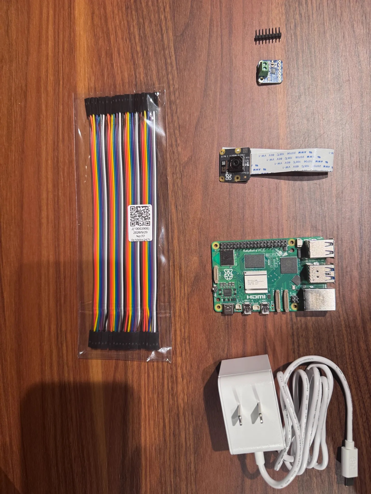
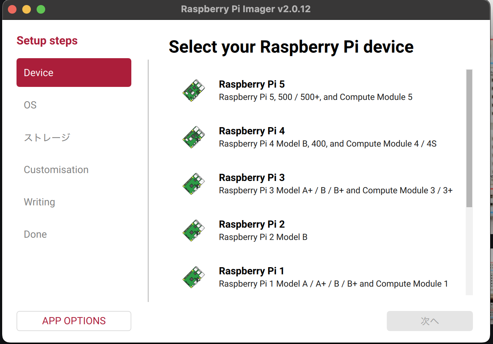
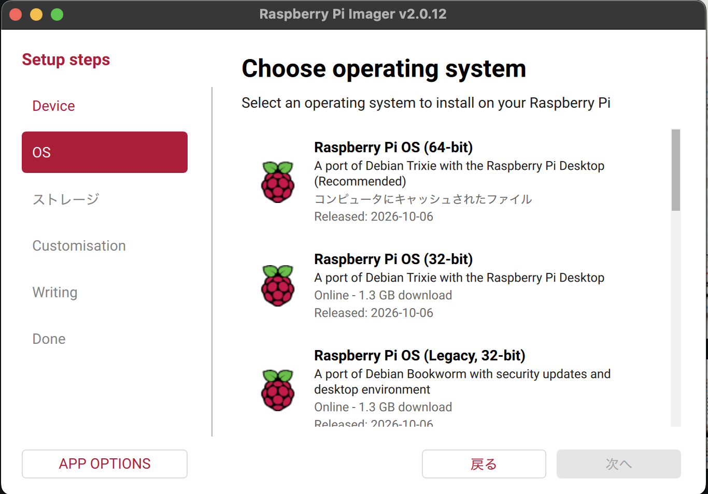
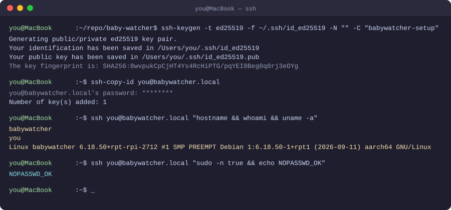
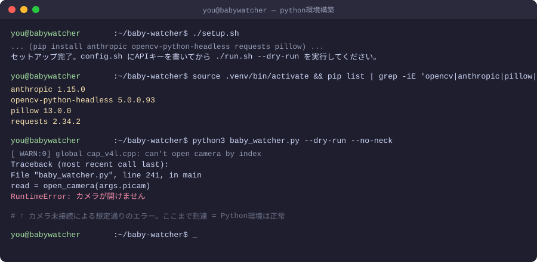
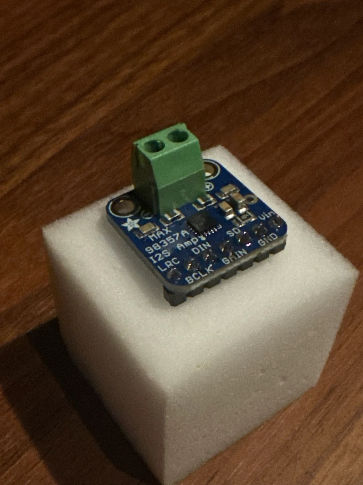

# はじめに

[前回](./qiita_draft.md)でアーキテクチャが確定したので、今回は実際に部品を発注し、届いたところからRaspberry Pi 5の初期セットアップと、唯一半田付けが必要なパーツの下準備までを進めます。

コードはGitHubで公開しています → [Haradasn/baby-watcher](https://github.com/Haradasn/baby-watcher)

# 部品到着

まずRaspberry Pi 5本体・カメラ・電源・MAX98357A(アンプ)・ジャンパーワイヤーが届きました。



# Raspberry Pi 5の初期セットアップ

## OS書き込み

Raspberry Pi Imagerを使い、モニター・キーボードなしで初回セットアップできる「ヘッドレス設定」でmicroSDにOSを書き込みました。詳細設定で以下を済ませています。

- ホスト名・ユーザー名・パスワード
- Wi-Fi設定
- SSHの有効化(パスワード認証)
- ロケール(Asia/Tokyo, jp配列)





デバイスは「Raspberry Pi 5」、OSは一番上の「Raspberry Pi OS (64-bit)」を選択しました。このあとストレージ選択→詳細設定(Customisation)でユーザー名・Wi-Fi・SSHなどを設定しています(この先の画面はユーザー名やパスワードが映り込むため、記事には載せていません)。

## SSH鍵認証とパスワードレスsudoの設定

毎回パスワードを打たなくて済むよう、SSH鍵認証を設定しました。Claude Codeに作業してもらう都合上、**鍵認証さえ通してしまえば、以降の操作はこちらで代行できる**ようにしています。



`sudo`は鍵認証とは別にアカウントパスワードを要求する仕組みなので、こちらは一度だけ手動でパスワードを入力し、NOPASSWD設定を追加しました。これでClaude Codeからのコマンド実行がすべて自動化できます。

## プロジェクトコードの転送とPython環境構築

`scp`でコード一式(`baby_watcher.py`, `face.py`, `neck.py`, `voice.py`など)を転送し、`setup.sh`でPython仮想環境を構築しました。



カメラ・ディスプレイ・サーボはまだ物理的に繋がっていないため、`--dry-run --no-neck`で実行すると想定通り「カメラが開けません」で止まります。ここまでエラーなく到達したことで、**Python環境・依存パッケージ・設定ファイルの読み込みはすべて正常**ということが確認できました。

`face.py`・`neck.py`・`voice.py`は、対応するハードウェア用ライブラリが無い環境でもimportエラーにならないよう設計しているので、ハードウェア未接続の段階でもこうした健全性チェックができます。

```python
try:
    from adafruit_servokit import ServoKit
    _kit = ServoKit(channels=16)
    HAS_HW = True
except Exception:
    _kit = None
    HAS_HW = False
```

# MAX98357A(I2Sアンプ)の半田付け

届いた4点のうち、MAX98357Aだけはピンヘッダーが別添えで、自分で半田付けする必要があります。

## 使うピンの確認

| ピン名 | 用途 |
|---|---|
| LRC | I2S LRCLK → GPIO19(pin35) |
| BCLK | I2S ビットクロック → GPIO18(pin12) |
| DIN | I2Sデータ入力 → GPIO21(pin40) |
| GAIN | ゲイン設定(今回は未使用) |
| SD | シャットダウン/モード制御 → GPIO23(pin16) |
| VIN | 電源入力 → Pi5の5V |
| GND | グラウンド → Pi5のGND |

付属のピンヘッダーは8ピンだったため、ニッパーで1本折って7ピンに調整しました。

## 半田付け

ブレッドボードが手元になかったので、乾いたメラミンスポンジ(いわゆる激落ちくん系)にピンを刺して仮固定する方法で代用しました。はんだはgoot社の鉛入りはんだ(SE-76008, 0.8mm)を使用し、こて先温度は320〜350℃に設定しています。



まだピンヘッダーを取り付ける前、端子台だけが実装された状態です。この上にピンヘッダーを挿したメラミンスポンジを重ねて半田付けしました。

> 📷 **ここに写真を貼る: 半田付け後のMAX98357A**
> ピンが7本とも綺麗な円錐状に仕上がっているのが伝わるアングルで、できれば真上から。

# まとめ・次回予告

今回は、先に届いた4点を使ってRaspberry Pi 5のソフトウェア環境を整え、MAX98357Aの半田付けまで終えました。残りの部品(ディスプレイ・サーボ・カメラケーブルなど)の到着待ちです。

次回は、全部品が揃い次第の物理的な組み立てと、実際にカメラ映像・表情・音声を動かすところまで進める予定です。

子どもが寝ている間の細切れ時間で進めているので、気長に更新していきます。

# 参考

- 本プロジェクトは個人のPoCであり、実際の乳児の安全監視を代替するものではありません
