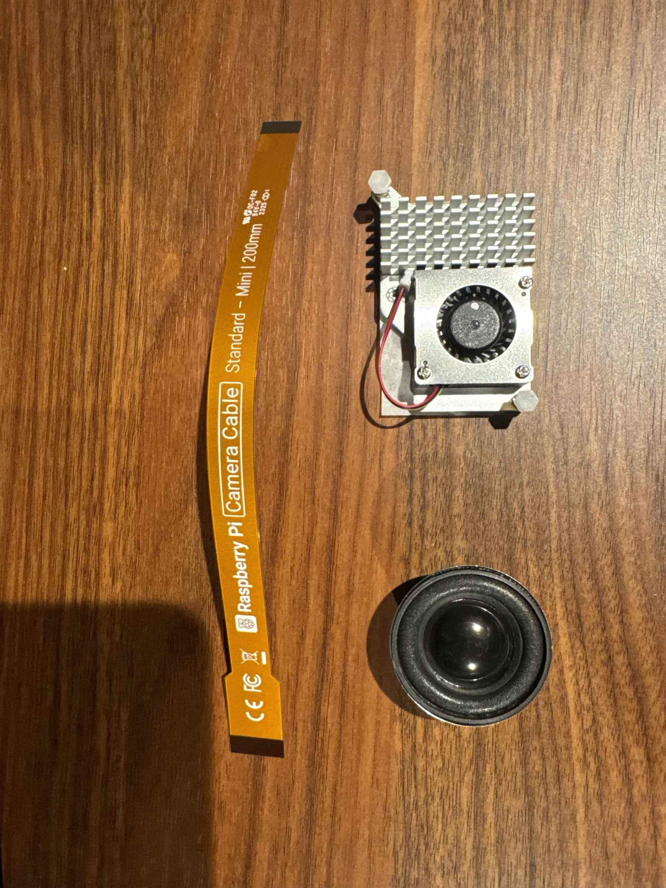
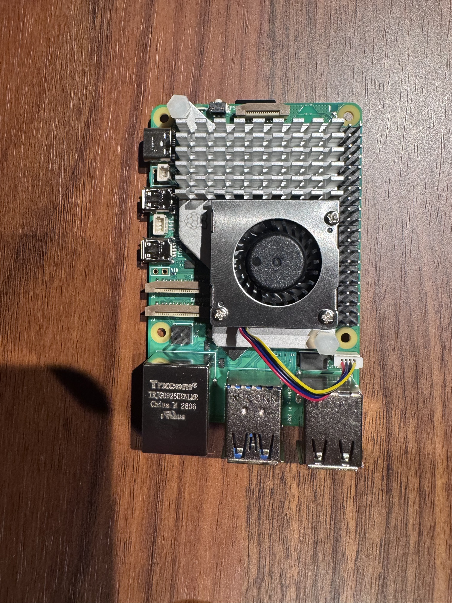
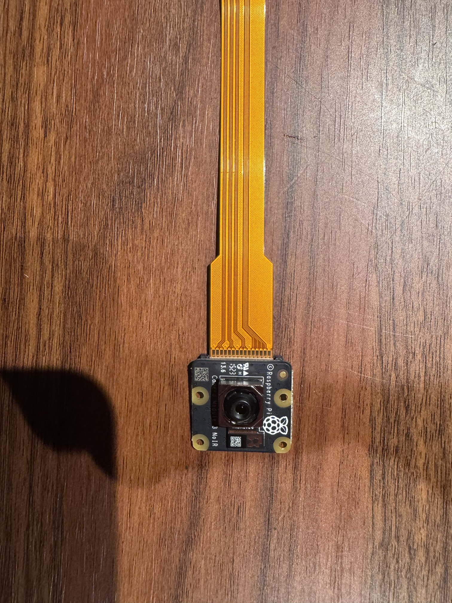
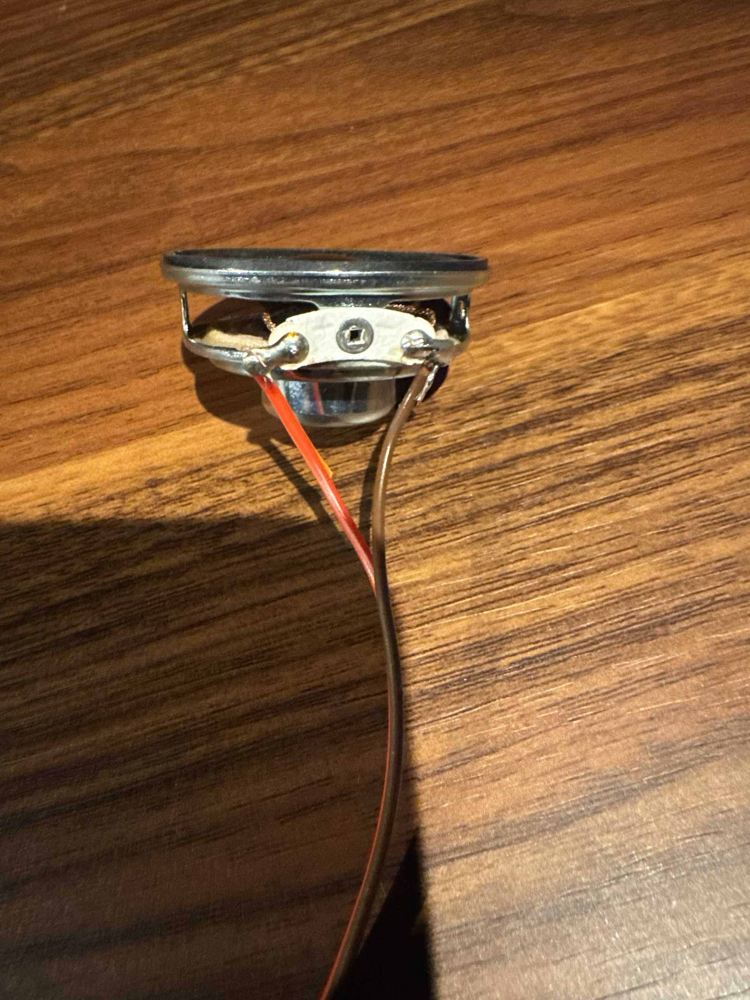
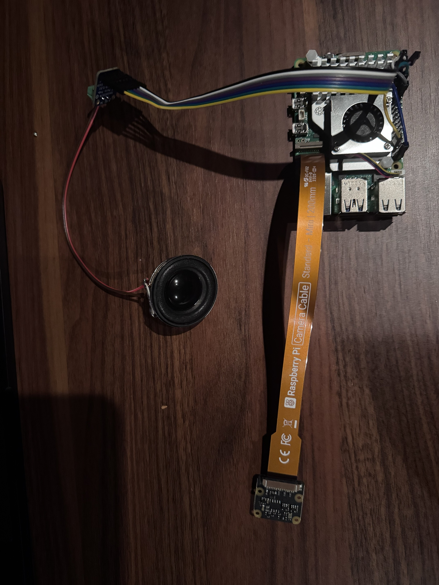
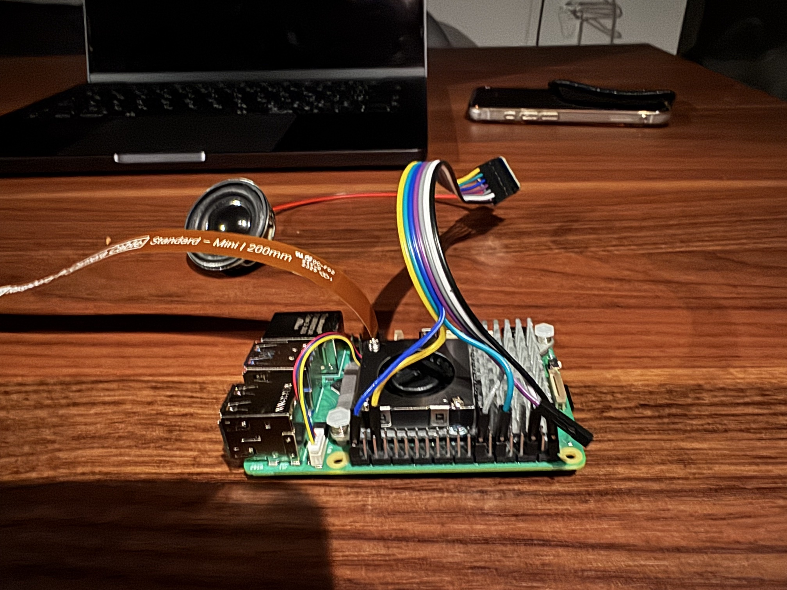

# はじめに

[前回](./qiita_draft_2.md)はRaspberry Pi 5の初期セットアップとMAX98357Aの半田付けまで進めました。今回は、届いた部品を使って実際にカメラ・冷却ファン・スピーカーを接続し、声を出せるところまで進めます。

コードはGitHubで公開しています → [Haradasn/baby-watcher](https://github.com/Haradasn/baby-watcher)

# 部品到着(続き)

秋月電子から、CSIケーブル・Active Cooler・スピーカーユニットの3点が届きました。これでディスプレイとサーボ系以外はすべて揃った状態です。



# Active Coolerの取り付け

公式のActive Coolerを本体に取り付けます。

1. 熱伝導パッドの保護紙を剥がす
2. Pi5の電源が切れていることを確認
3. 白い2本のプッシュピンを、SoC横の2つの穴に合わせる
4. 2本のピンを同時に均等に押し込み、カチッと音がするまで固定
5. ファンケーブルを基板上の「FAN」コネクタに接続



# カメラの接続

Camera Module V3 NoIRを、CSIケーブルでPi5のCSI0コネクタに接続します。

1. コネクタのフラップ(黒い爪部分)を、止まるところまで軽く引き出す
2. フラップを少し斜めに倒す
3. ケーブルの金属接点がフラップと反対側を向くように差し込み、まっすぐ奥まで挿入
4. フラップを元の位置に倒して、カチッと言うまで押し込む
5. カメラ本体側のコネクタも同様に接続



# MAX98357A + スピーカーの配線

半田付け済みのMAX98357Aを、ジャンパーワイヤーでPi5のGPIOに接続します。配線は[前々回](./qiita_draft.md)の配線図のI2S系統の通りです。

| アンプ側 | Pi5側(BCM/物理ピン) |
|---|---|
| VIN | 5V (pin2) |
| GND | GND (pin6) |
| BCLK | GPIO18 (pin12) |
| LRC | GPIO19 (pin35) |
| DIN | GPIO21 (pin40) |
| SD | GPIO23 (pin16、ミュート制御) |

スピーカー(秋月の4cm 4Ωユニット)はリード線が付いていない裸のユニットなので、ジャンパーワイヤーの両端のコネクタをニッパーで切り落として被覆を剥き、片方をスピーカー端子に半田付け、もう片方をMAX98357Aの端子台にネジ止めしました。



配線がすべて終わった状態がこちらです。





# 動作確認

SSH経由で、各デバイスが正しく認識・動作しているか確認しました。

```
you@babywatcher:~$ rpicam-hello --list-cameras
Available cameras
-----------------
0 : imx708_noir [4608x2592 10-bit RGGB] (/base/axi/pcie@1000120000/rp1/i2c@88000/imx708@1a)
```

カメラは`imx708_noir`として正しく認識されました。

Active Coolerは、CPU温度が50℃を超えたあたりで自動的に回転を始めることを、簡単な負荷テストで確認しました(アイドル時は停止したままで静かです)。

```
you@babywatcher:~$ vcgencmd measure_temp
temp=50.5'C
you@babywatcher:~$ cat /sys/devices/platform/cooling_fan/hwmon/hwmon2/fan1_input
2563
```

# Piper TTSの導入

音声合成には[Piper](https://github.com/OHF-Voice/piper1-gpl)を使います。日本語の音声モデルはOpenJTalkベースの音素化が必要なため、Pythonパッケージ版(`[ja]`エクストラ付き)をインストールしました。

```
you@babywatcher:~/baby-watcher$ source .venv/bin/activate
you@babywatcher:~/baby-watcher$ pip install 'piper-tts[ja]'
```

日本語音声モデル(`ja_JP-hi_fi_captain-medium`)は[Hugging Face](https://huggingface.co/rhasspy/piper-voices/tree/main/ja/ja_JP/hi_fi_captain/medium)から取得し、`~/piper/`に配置します。

```
you@babywatcher:~$ mkdir -p ~/piper
you@babywatcher:~$ wget -O ~/piper/ja_JP-voice.onnx https://huggingface.co/rhasspy/piper-voices/resolve/main/ja/ja_JP/hi_fi_captain/medium/ja_JP-hi_fi_captain-medium.onnx
you@babywatcher:~$ wget -O ~/piper/ja_JP-voice.onnx.json https://huggingface.co/rhasspy/piper-voices/resolve/main/ja/ja_JP/hi_fi_captain/medium/ja_JP-hi_fi_captain-medium.onnx.json
```

I2Sアンプを使うため、`/boot/firmware/config.txt`に以下を追加しました。SD(ミュート制御)ピンをGPIO23に配線した設計に合わせて、`sdmode-pin`を明示的に指定しています。

```
dtparam=i2s=on
dtoverlay=max98357a,sdmode-pin=23
```

設定反映のため再起動すると、`MAX98357A`という名前のサウンドカードが認識されるようになりました。

```
you@babywatcher:~$ aplay -l
card 2: MAX98357A [MAX98357A], device 0: 1f000a0000.i2s-HiFi HiFi-0 [1f000a0000.i2s-HiFi HiFi-0]
```

## 音量の調整

赤ちゃんのそばに置く機器なので、音量は控えめに設定したいところです。Piperには`--volume`オプションが用意されているので、`voice.py`から呼び出す際にこれを使って音量を絞っています。実際に何段階か試し聞きして、`VOICE_VOLUME=0.1`に落ち着きました。

```python:voice.py(抜粋)
subprocess.run(
    [
        "python3", "-m", "piper",
        "-m", PIPER_MODEL,
        "-f", path,
        "--volume", VOICE_VOLUME,
    ],
    input=text.encode("utf-8"),
    check=True,
    capture_output=True,
    timeout=15,
)
```

```
you@babywatcher:~/baby-watcher$ python3 -c "
import voice
voice.speak('パパがそばにいるよ')
"
```

実際に発話させてみると、ちゃんと聞き取れる声量で「パパがそばにいるよ」と再生されました。

# まとめ・次回予告

今回は、カメラ・Active Cooler・MAX98357A(+スピーカー)の物理的な接続と、Piper TTSによる日本語音声合成の導入までを終えました。カメラ認識・冷却ファンの自動回転・音声合成/再生のすべてを実機で確認できています。

次回は、残りの部品(GC9A01ディスプレイ・PCA9685・SG90サーボ)が揃い次第、表情描画と首振り機構を組み込んで、ようやく見た目にも「ロボットらしい」形に近づける予定です。

子どもが寝ている間の細切れ時間で進めているので、気長に更新していきます。

# 参考

- 本プロジェクトは個人のPoCであり、実際の乳児の安全監視を代替するものではありません
- 使用モデル: Claude Haiku(画像判定)、Claude Opus(アーキテクチャレビュー)
